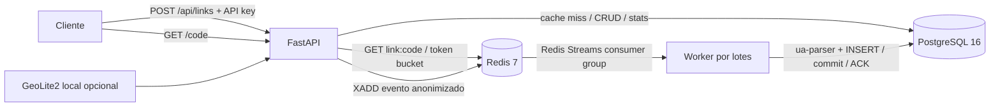

# Acortador de URLs

Servicio HTTP con FastAPI, PostgreSQL 16 y Redis 7. Crea enlaces, redirige con HTTP
302 y procesa estadísticas en un worker separado. Python 3.12; dependencias fijadas
en `uv.lock`.



## Ejecución local

Necesitas Docker Engine y Docker Compose v2. Desde la raíz:

```sh
cp .env.example .env
docker compose up --build -d
docker compose ps
curl --fail http://localhost:8000/readyz
```

La API escucha en el puerto 8000. PostgreSQL y Redis permanecen en la red interna
de Compose; sus datos se conservan en volúmenes. `docker compose down` detiene los
servicios; `docker compose down -v` elimina sus datos. Swagger está en `/docs`.

En un entorno administrado con proxy de inspección TLS, usa la configuración de
construcción que monta el certificado del sistema como secreto temporal de
BuildKit, manteniendo la verificación TLS:

```sh
docker compose -f compose.yaml -f compose.cloud.yaml build
docker compose up -d
```

Para repetir la preparación del entorno administrado, ejecuta
[`bash .cloud/install.sh`](.cloud/install.sh). Las instrucciones de arranque,
comprobación y recuperación de servicios están en [`.cloud/START.md`](.cloud/START.md).
Usan el checkout existente y conservan cualquier `.env` local.

Los valores incluidos en `.env.example` son para desarrollo local. Antes de exponer
el servicio, configura claves propias, `CODE_SECRET`, `IP_HASH_SECRET`, credenciales
de PostgreSQL y `BASE_URL` con tu dominio HTTPS. Termina TLS en un proxy y configura
explícitamente cualquier confianza en cabeceras de cliente. El servidor incluido
no confía en `X-Forwarded-For`: no permite que un visitante eluda el límite o falsee
la IP mediante esa cabecera.

`API_KEYS` es un objeto JSON que asigna claves a propietarios, por ejemplo
`{"clave-personal":"alice","otra-clave":"bob"}`. Las claves autentican creación,
edición y estadísticas con `X-API-Key`; la redirección es pública. No publiques
claves reales ni tu archivo `.env`.

## API

```sh
curl --fail-with-body http://localhost:8000/api/links \
  -H 'X-API-Key: dev-api-key' \
  -H 'Content-Type: application/json' \
  -d '{"target_url":"https://example.com/","alias":"mi-enlace"}'

curl -i http://localhost:8000/mi-enlace

curl --fail-with-body http://localhost:8000/api/links/mi-enlace/stats \
  -H 'X-API-Key: dev-api-key'

curl --fail-with-body -X PATCH http://localhost:8000/api/links/mi-enlace \
  -H 'X-API-Key: dev-api-key' \
  -H 'Content-Type: application/json' \
  -d '{"is_active":false}'
```

`POST /api/links` devuelve HTTP 201 con `code` y `short_url`. Omite `alias` para
generarlo automáticamente; `expires_at` admite fecha ISO 8601 con zona horaria.
Los alias deben cumplir `^[A-Za-z0-9_-]{3,32}$`; las rutas reservadas no se pueden
usar como alias. Un alias ocupado devuelve conflicto. Los enlaces desactivados,
vencidos o inexistentes devuelven 404. La edición invalida la caché. Las operaciones
de gestión sobre un enlace de otro propietario también devuelven 404.

`GET /api/links/{code}/stats` ofrece el total y agregaciones por día UTC, país,
dispositivo, navegador y referer. El worker actualiza estas estadísticas de forma
eventual: un clic puede tardar hasta el intervalo de vaciado y el tiempo de
procesamiento de la cola en aparecer.

## Decisiones y límites

- **Códigos sin colisiones:** `BIGSERIAL` asigna un id; una permutación biyectiva de
  64 bits con XOR y multiplicación impar lo ofusca antes de codificar en base62.
  El prefijo `~` separa los códigos generados de los alias. La permutación oculta
  la secuencia a simple vista; no es cifrado ni sustituye autorización. No cambies
  `CODE_SECRET` si necesitas reproducir la misma relación id/código.
- **Ruta de redirección:** caché positiva `link:{code}`, TTL acotado por la
  caducidad del enlace y fallback a PostgreSQL. Una ausencia se cachea durante
  pocos segundos para limitar consultas repetidas. `CACHE_TTL_SECONDS=0` permite
  medir la resolución en PostgreSQL sin caché positiva. El endpoint usa 302 para
  que las visitas vuelvan al servicio y puedan contarse.
- **Caída de Redis:** las redirecciones continúan consultando PostgreSQL; durante
  la caída se omite su rate limiting y los clics que no se pueden encolar se
  pierden, dejando un mensaje de error en los logs. Es una decisión explícita de
  disponibilidad; no garantiza conteos completos ni protección contra abuso en
  ese escenario. Las operaciones de gestión devuelven 503 si el limitador no
  está disponible. Si la invalidación falla después del commit de una creación
  o edición, la operación devuelve 503 indicando que la BD ya se actualizó;
  reintenta la edición para invalidar la caché. Supervisa estas respuestas y la
  salud de Redis.
- **Métricas fuera de la BD del request:** la API publica en Redis Streams y el
  worker agrupa escrituras por tamaño o intervalo. Confirma eventos después del
  commit; un `event_id` único evita duplicados al reentregar. La cola también
  recupera mensajes pendientes de consumidores que dejaron de trabajar. Redis
  usa persistencia AOF; para producción define respaldo, límites de disco y
  alertas del retraso del consumer group. No se recorta la cola sacrificando
  eventos pendientes.
- **Privacidad:** nunca se persiste la IP en claro. Cada evento contiene un hash
  SHA-256 con sal diaria derivada de `IP_HASH_SECRET`. El user-agent se interpreta
  con `ua-parser`; los metadatos de eventos tienen límites de longitud. Los
  referers se guardan sin credenciales, query ni fragmento, aunque la ruta aún
  puede contener información personal: define su retención según tu política de
  privacidad.
- **GeoIP opcional:** monta una base GeoLite2 Country de MaxMind en una ruta de
  solo lectura y configura `GEOIP_DATABASE_PATH`. No se incluye la base por sus
  requisitos de licencia y descarga. Sin ella, el país se registra como
  desconocido; no se llama a servicios externos de geolocalización.
- **Control de abuso:** token bucket atómico en Redis; autenticación por
  propietario para operaciones de gestión; solo destinos HTTP/HTTPS con longitud
  limitada. Se rechazan localhost, credenciales en URL, IPs no públicas y nombres
  que resuelven a direcciones no públicas. `BLOCKED_DOMAINS` añade una lista de
  dominios bloqueados en formato JSON, por ejemplo `["malicioso.example"]`.
  La validación DNS ocurre al crear o editar: un dominio
  público puede cambiar su DNS posteriormente. Un acortador público necesita
  además políticas de abuso y, si corresponde, una lista positiva de destinos.
- **Esquema:** índice único en `links.code` e índice compuesto en
  `clicks(link_id, ts)`. `clicks` no está particionada en este proyecto inicial;
  considera particiones mensuales cuando los volúmenes y la retención lo
  justifiquen. No hay evidencia de volumen que compense su coste operativo aquí.
  El arranque inicial crea las tablas; para evolucionar un despliegue con datos,
  añade migraciones versionadas antes de cambiar el esquema.

## Desarrollo y pruebas

Con Python 3.12 y [uv](https://docs.astral.sh/uv/):

```sh
uv sync --frozen
uv run ruff check .
uv run pytest -m 'not integration'
uv run pytest -m integration
```

Las pruebas de integración requieren Docker y levantan PostgreSQL 16 y Redis 7
mediante Testcontainers. Ejercitan el servicio y el procesamiento de clics con
dependencias reales. Las unitarias verifican, entre otros casos, la ausencia de
colisiones del generador para un millón de ids. GitHub Actions ejecuta lint,
pruebas y construcción de la imagen.

Validación realizada en este entorno: **77 pruebas aprobadas**, incluidas **9 de
integración**; imagen construida y los cuatro servicios de Compose saludables.
También se ejecutó el script de preparación del entorno administrado.

## Benchmark de redirecciones

`benchmarks/redirect.js` crea un enlace de prueba y mide únicamente las
redirecciones, sin seguirlas. Verifica HTTP 302 y `Location`; un error hace fallar
el benchmark. El calentamiento y la creación no se incluyen en
`redirect_latency`. El informe JSON conserva p50, p95 y p99 en milisegundos,
cantidad de redirecciones y tasa de errores.

La comparación usa el mismo destino, carga y worker. La variante `warm` calienta
la caché; `disabled` configura `CACHE_TTL_SECONDS=0`, por lo que cada resolución
consulta PostgreSQL. `CACHE_MODE` solo etiqueta resultados; no cambia el servidor.
Eleva el límite durante esta medición aislada para medir resolución y no respuestas
429. Reinicia la API al cambiar variables y restaura después los límites normales.

```sh
mkdir -p benchmark-results

# Redis caliente; la primera petición del setup precarga la entrada.
CACHE_TTL_SECONDS=300 RATE_LIMIT_CAPACITY=100000 RATE_LIMIT_REFILL_PER_SECOND=100000 \
  docker compose up -d --force-recreate api
docker compose --profile tools run --rm --no-deps \
  -e CACHE_MODE=warm -e TARGET_URL=https://8.8.8.8/ \
  -e SUMMARY_PATH=/results/warm.json \
  k6 run /scripts/redirect.js

# Cada resolución consulta PostgreSQL; Redis sigue siendo la cola y el limitador.
CACHE_TTL_SECONDS=0 RATE_LIMIT_CAPACITY=100000 RATE_LIMIT_REFILL_PER_SECOND=100000 \
  docker compose up -d --force-recreate api
docker compose --profile tools run --rm --no-deps \
  -e CACHE_MODE=disabled -e TARGET_URL=https://8.8.8.8/ \
  -e SUMMARY_PATH=/results/disabled.json \
  k6 run /scripts/redirect.js

# Restaura los TTL y límites definidos en .env o los valores por defecto.
docker compose up -d --force-recreate api
```

Las corridas usan 10 usuarios concurrentes y 30 segundos por defecto. Ajusta
`-e VUS=... -e DURATION=...` en ambos comandos de k6 para mantener una carga
comparable. Si cambiaste las claves, configura `BENCHMARK_API_KEY` desde una variable
de entorno segura. Espera a `/readyz` después de recrear la API antes de lanzar
cada corrida. Revisa también que el worker drene la cola; latencias bajas con una
cola que crece indefinidamente no demuestran capacidad sostenida.

`--no-deps` conserva la API con los TTL y límites de la variante seleccionada;
el servicio ya debe estar iniciado y saludable. El contenedor k6 excluye `api` del
proxy HTTP para llegar directamente a la red interna de Compose.

El servicio k6 usa el uid/gid 1000 para poder escribir artefactos en un host Linux
convencional. Ajusta `LOCAL_UID` y `LOCAL_GID` al dueño del directorio de resultados.
En Docker rootless del entorno administrado, `LOCAL_UID=0 LOCAL_GID=0` permite
acceder a los bind mounts privados del checkout; esos ids pertenecen al espacio de
nombres del contenedor.

Resultados medidos el **7 de noviembre de 2026**, con k6 1.0.0, 10 usuarios
concurrentes durante 30 segundos por variante, sin pausas entre peticiones:

| Resolución | Redirecciones medidas | Errores | p50 (ms) | p95 (ms) | p99 (ms) |
| --- | ---: | ---: | ---: | ---: | ---: |
| Caché caliente, TTL 300 s | 67 900 | 0 % | 4.105 | 6.331 | 8.054 |
| Caché desactivada, TTL 0 | 22 193 | 0 % | 12.410 | 20.153 | 27.040 |

API, PostgreSQL, Redis, worker y k6 corrieron en el mismo host cloud, con 5 CPU y
33 GiB visibles, Docker rootless y almacenamiento `vfs`. La carga viajó por la red
interna de Compose, con HTTP sin TLS; el destino fue `https://8.8.8.8/`, sin seguir
la redirección. No se ejecutaron tests ni builds simultáneamente. El worker usó
lotes de 100 eventos o 1 segundo. Al terminar se verificó `pending=0`, `lag=0` y
67 901/22 194 clics persistidos respectivamente: las redirecciones medidas más la
petición de calentamiento de cada corrida.

El [resumen medido](benchmarks/results/baseline.json) conserva parámetros y
precisión original. Se ejecutó una corrida por variante; los números dependen del
hardware compartido, la concurrencia y el estado de la base. Estas mediciones
locales no establecen capacidad de producción ni estabilidad sostenida de la cola.
Los informes completos de cada corrida se guardan en `benchmark-results/` con
Compose, o en `benchmarks/results/` con k6 instalado localmente.
